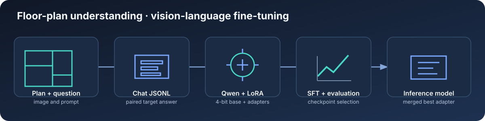

<h1 align="center">Floor-Plan Vision-Language Fine-Tuning</h1>

<p align="center">
  
  
  
  
  
  
</p>

Fine-tune a vision-language model to read architectural floor plans and answer structured questions about rooms, fixtures, doors, windows, counts, comparisons, and geometric relationships.

This repository contains a Qwen3.5-9B + Unsloth training pipeline using supervised fine-tuning and PEFT/LoRA adapters. It includes chat-style JSONL data, image preprocessing, multi-GPU launch support, checkpoint selection, logs, and inference utilities.



## Contents

- [Project at a glance](#project-at-a-glance)
- [How it works](#how-it-works)
- [Data: where each file belongs](#data-where-each-file-belongs)
- [Model files and saved artifacts](#model-files-and-saved-artifacts)
- [Language models, encoders, and decoders](#language-models-encoders-and-decoders)
- [Why a vision-language model](#why-a-vision-language-model)
- [Model choice: Qwen3.5-9B](#model-choice-qwen35-9b)
- [Fine-tuning concepts](#fine-tuning-concepts)
- [Repository layout](#repository-layout)
- [Environment setup](#environment-setup)
- [Download a model](#download-a-model)
- [Prepare the dataset](#prepare-the-dataset)
- [Train](#train)
- [Monitor and inspect outputs](#monitor-and-inspect-outputs)
- [Run inference](#run-inference)
- [Results](#results)
- [GitHub publishing notes](#github-publishing-notes)
- [Detailed training notes](FINETUNING.md)

## Project at a glance

| Item | Current project setup |
| --- | --- |
| Task | Visual question answering and structured floor-plan interpretation |
| Base model | Qwen3.5-9B at `models/Qwen3.5-9B` |
| Training | Supervised fine-tuning (SFT) with PEFT LoRA adapters |
| Memory | 4-bit base loading, gradient checkpointing, resized/cached images |
| Stack | PyTorch, Transformers, Datasets, TRL, PEFT, Unsloth, Accelerate |
| Data | JSONL chat messages with image and text content |
| Artifacts | Adapter checkpoints, merged model, logs, run summary, TensorBoard |

The active model and training parameters are centralized in `config.yaml`. The model downloader accepts an alternate repository ID and destination for optional model variants.

## How it works

```text
Floor-plan image + question
            │
            ▼
   JSONL chat example ──► image resize/cache + Qwen processor
                                      │
                                      ▼
              Qwen3.5-9B base + trainable LoRA adapters
                                      │
                              supervised fine-tuning
                                      │
                    validation + best-checkpoint selection
                                      │
                                      ▼
                 adapter checkpoint ──► merged inference model
```

The model is trained to produce answers represented in the examples. The dataset includes counting and comparison questions, junction detection, and annotations with polygon coordinates. The pipeline does not produce CAD/BIM files or guarantee building-code correctness.

## Data: where each file belongs

The repository separates source annotations, source images, model-ready conversations, and generated caches. This makes it easier to trace each training answer back to its original floor-plan labels.

```text
raw_data/
├── images/                 # Original floor-plan image files
└── json/                   # Per-image annotation files (LabelMe-style JSON)

train_data/
├── vlm_train.jsonl         # Training conversations sent to the VLM
├── vlm_val.jsonl           # Validation conversations
├── image_cache/            # Resized image cache; generated during training
└── src/
    ├── core/               # Class names, path handling, question/answer templates
    └── relation_logic/     # Geometry and spatial-relation helpers
```

### Source annotation format

The source files in `raw_data/json/` are per-plan annotation documents. A typical file has image dimensions, an image path, and a `shapes` list. Each shape carries a class label, points, and shape metadata. The `generate_data.py` script combines these annotations with their corresponding images to create question/answer examples.

```json
{
  "imagePath": "00003.png",
  "imageHeight": 768,
  "imageWidth": 1024,
  "shapes": [
    {
      "label": "Bedroom",
      "points": [[120, 80], [360, 80], [360, 280], [120, 280]],
      "shape_type": "polygon"
    }
  ]
}
```

The example is abbreviated. Keep the original annotation fields required by the generator. Image names in annotation JSON must resolve to files under `raw_data/images/`.

Generate the train/validation chat files from the source annotations with:

```bash
python generate_data.py
```

The generator uses the helper modules under `train_data/src/`, creates a deterministic image-level split, and writes the JSONL files named in `config.yaml`. Review its printed sample/image counts before training.

### Model-ready conversation format

The training script reads one JSON object per line from each JSONL file. Each record contains user content (image and question) and assistant content (the expected answer). This format lets the model learn both how to inspect the image and how to format its answer.

```text
raw annotations + images
         │  generate_data.py
         ▼
train and validation JSONL ──► train.py
                                   │
                                   └──► train_data/image_cache/
```

Keep the same plan entirely within one split. If near-identical views of a plan appear in both splits, validation results can look better than performance on new plans. Use relative image paths such as `raw_data/images/plan.png`; avoid machine-specific absolute paths.

The JSONL files and source floor-plan collection are excluded from Git by default because they are large and may have sharing restrictions. A fresh clone needs an authorized copy of the data at the paths in `config.yaml` before it can train.

In the current training collator, labels are copied from the formatted token sequence and padding/image placeholder tokens are masked with `-100`. The remaining formatted text tokens contribute to the language-model loss. If changing this to assistant-response-only loss, update the collator and validate the new masking behavior deliberately.

## Model files and saved artifacts

The repository separates pretrained model files from fine-tuning outputs:

```text
models/
└── Qwen3.5-9B/
    ├── config.json                 # Architecture and model configuration
    ├── model.safetensors           # Pretrained tensor weights
    ├── generation_config.json      # Generation defaults
    ├── processor_config.json       # Image/text processor configuration
    ├── tokenizer.json              # Token vocabulary and tokenizer rules
    ├── tokenizer_config.json       # Tokenizer settings/chat metadata
    └── chat_template.jinja         # Conversation formatting template

outputs/qwen35-floorplan-lora/
├── checkpoint-N/                   # Intermediate LoRA adapter/trainer state
├── best-checkpoint/                # Alias to the validation-selected adapter
├── merged-best/                    # Base weights with the adapter merged in
├── training.log                    # Human-readable training output
└── run_summary.json                # Settings and final checkpoint metrics
```

The exact files can vary by Transformers/model revision. The important distinction is that the base model directory supplies pretrained capabilities, checkpoints contain the learned adapter, and `merged-best/` is the convenient full model for inference. Model weights and training outputs are ignored by Git; download/rebuild them locally instead of committing multi-gigabyte files.

## Language models, encoders, and decoders

Before choosing a model, it helps to distinguish how models read input and produce output:

- **Encoder:** reads an input sequence and builds contextual representations. It is useful for understanding/classification tasks, but an encoder alone is not usually designed to generate a long answer token by token.
- **Decoder:** predicts the next token from the preceding context, repeatedly, to generate text. GPT-style language models are commonly decoder-only.
- **Encoder-decoder:** an encoder represents the input, then a separate decoder generates an output conditioned on that representation. Translation and summarization models often use this pattern.

These are broad architecture patterns. A vision-language model adds a visual pathway: image pixels are converted into visual features, then combined with language context so the language-generation component can answer a question. Implementations may use a separate vision encoder and a connector/projector, or integrate vision processing into a larger multimodal architecture. The processor handles the model-specific image resizing, image tokens, and chat formatting.

For this project, think of the two inputs flowing side by side into one generation task:

```text
floor-plan pixels ─► vision pathway ─┐
                                     ├─► multimodal context ─► language decoder ─► answer tokens
question text ─────► tokenizer ─────┘
```

## Why a vision-language model

A text-only language model can reason over words, but it cannot inspect pixels in a floor-plan image unless another system first converts that image into text or structured data. This project asks questions whose answers depend on the image itself: where rooms are, how many doors appear, whether a junction exists, and which coordinates describe an annotation.

The chosen checkpoint therefore needs both:

1. **Vision capability** to accept a floor-plan image and turn its visual content into model features.
2. **Language-model capability** to understand the question and generate a useful answer, including the required JSON structure.

The repo's processor accepts image plus text, and the trainer uses a vision-language conditional-generation model. The generated response is still language-model output, but its context includes visual features from the plan. A text-only checkpoint would not satisfy the input requirements of this task.

## Model choice: Qwen3.5-9B

The default model is **Qwen3.5-9B**, configured in `config.yaml` and stored locally at `models/Qwen3.5-9B/`. This choice follows from the task and the implementation already present in the repository:

- **Image and text in one model:** the Qwen checkpoint and processor support image-text conditional generation, which matches the image-plus-question training records.
- **Generative answers:** the decoder-style language generation path can produce natural-language explanations or structured JSON strings for counts, comparisons, and annotations.
- **Useful capacity for detailed plans:** a 9B-class model provides more representation capacity than a small edge model for dense architectural drawings, while remaining smaller than the optional 32B checkpoint in this repo.
- **Fits the training approach:** the local model is loaded through Unsloth, supports adapter fine-tuning through PEFT/LoRA, and can be loaded in 4-bit to reduce memory requirements.
- **End-to-end artifacts:** the same model family supplies the processor, chat template, and inference model, avoiding a separate vision model and text model integration step.

This is an engineering choice, not a claim that it is the only suitable model. The right size depends on GPU memory, image resolution, dataset quality, license, and measured task performance. The 32B model files in this workspace are an optional alternative and are not selected by the default config.

The local checkpoint config identifies the architecture as `Qwen3_5ForConditionalGeneration` and contains both `text_config` and `vision_config` sections. The training code loads it with a vision-language conditional-generation API and a matching processor. These are the concrete reasons this checkpoint meets the project requirement for both image understanding and language generation.

## Fine-tuning concepts

### Dense and Mixture-of-Experts models

- **Dense model:** each token uses the same feed-forward blocks in each transformer layer; the full model participates for each token.
- **Mixture of Experts (MoE):** a router directs each token to one or more expert feed-forward blocks. An MoE can have many total parameters while activating only some experts for a token.
- Dense/MoE describes the base architecture. Fine-tuning does not convert one type into the other. Check the selected checkpoint's model card/config before describing its architecture.

### PEFT and LoRA

- **PEFT (Parameter-Efficient Fine-Tuning)** trains a small parameter subset while keeping most pretrained weights frozen. This reduces optimizer memory and usually produces smaller checkpoints.
- **LoRA (Low-Rank Adaptation)** adds trainable low-rank matrices to selected projections. The pretrained weights remain frozen during adapter training. The adapter can be saved separately or merged into the base weights.
- This project uses Unsloth's PEFT integration to add LoRA adapters to vision and language model components. It configures rank 16, alpha 32, dropout 0.05, and `target_modules="all-linear"`.

### QLoRA and 4-bit loading

**QLoRA** combines LoRA adapters with a quantized frozen base model, commonly loaded at 4-bit precision. That reduces memory while adapter parameters are trained. This repo enables 4-bit base loading and trains LoRA adapters, so the setup is QLoRA-style. Gradient checkpointing further reduces activation memory at the cost of recomputation.

### What the libraries do here

| Library | Role |
| --- | --- |
| **Unsloth** | Optimized vision-language model loading and LoRA training helpers. |
| **Transformers** | Loads the model, processor, and tokenizer; provides generation APIs. |
| **TRL** | Provides `SFTConfig` and `SFTTrainer` for supervised fine-tuning. |
| **PEFT** | Adds, saves, loads, and merges LoRA adapters. |
| **Datasets** | Reads train and validation JSONL splits. |
| **Accelerate** | Launches distributed multi-GPU training. |
| **bitsandbytes** | Supports low-bit model loading. |
| **TensorBoard** | Displays logged training and validation metrics. |

## Repository layout

```text
.
├── README.md                       # Overview and quick start
├── FINETUNING.md                   # Detailed concepts and code walkthrough
├── requirements.txt                # Python dependencies
├── config.yaml                     # Model, paths, LoRA, and training settings
├── finetune_run.sh                 # Start the configured training run
├── tensorboard.sh                  # Start TensorBoard on port 8501
├── inference.py               # Run image/question inference
├── model_downloader/               # Hugging Face model download utility
├── notebooks/extra/                # Optional exploration/inference notebooks
├── img/                             # README diagram and portfolio images
├── train.py     # Main training implementation
├── generate_data.py               # Build chat examples from source annotations
├── train_data/src/                  # Dataset generation helpers
├── raw_data/                        # Source images and annotation tools
├── models/                          # Local model files (excluded from Git)
└── outputs/                         # Logs/checkpoints/models (excluded from Git)
```

Exploration notebooks live under `notebooks/extra/`; the command-line path does not require them.

## Environment setup

Create a virtual environment and install the CUDA-enabled PyTorch build compatible with your machine before installing the remaining requirements.

```bash
python3 -m venv .venv
source .venv/bin/activate
python -m pip install --upgrade pip

# Example for CUDA 12.1; choose the wheel matching your CUDA/driver setup.
python -m pip install torch torchvision torchaudio --index-url https://download.pytorch.org/whl/cu121
python -m pip install -r requirements.txt
```

Requirements include Transformers, Datasets, TRL, PEFT, Accelerate, Unsloth dependencies, bitsandbytes, image utilities, and TensorBoard. For reproducibility, record `python --version`, `nvidia-smi`, and PyTorch's CUDA version.

## Configure the project

Edit the commented `config.yaml` instead of changing constants in the Python trainer. It groups settings by purpose:

- `model` — Hugging Face repository, local base model path, merged output path, and 4-bit loading.
- `data` — JSONL paths, sample percentages, image cache, image side limit, and sequence length.
- `training` — GPU IDs, batch sizes, gradient accumulation, optimizer schedule, checkpoints, and TensorBoard.
- `lora` — rank, alpha, dropout, target modules, and which model layers receive adapters.
- `evaluation` and `dataloader` — early stopping, best-checkpoint metric, and input worker settings.

Use environment variables for temporary path/GPU overrides (`MODEL_DIR`, `TRAIN_FILE`, `VAL_FILE`, `OUTPUT_DIR`, `GPU_IDS`, or `CONFIG_FILE`). Keep the YAML file as the reproducible project configuration.

## Download a model

The downloader reads the default repository and destination from `config.yaml`. Model weights are large; review model licenses/access terms and ensure adequate disk space.

```bash
python model_downloader/download.py
```

Override the repository or destination for an optional model:

```bash
python model_downloader/download.py \
  --model-id Qwen/Qwen3-VL-32B-Instruct \
  --destination models_32B
```

Authenticate with `hf auth login` first if the selected model requires access approval. The 32B model is substantially larger and is not the default training model.

## Prepare the dataset

Each line is a JSON object. A user message contains an image and question; the assistant message contains the target answer.

```json
{"messages":[
  {"role":"user","content":[
    {"type":"image","image":"raw_data/images/example_floor_plan.png"},
    {"type":"text","text":"How many bedrooms are shown? Reply as JSON."}
  ]},
  {"role":"assistant","content":[
    {"type":"text","text":"{\"bedroom_count\":2}"}
  ]}
]}
```

Put records in `train_data/vlm_train.jsonl` and `train_data/vlm_val.jsonl`. Check that images exist, answer schemas are consistent, polygon coordinates use a documented convention, and validation floor plans do not overlap training plans. Relative image paths are more portable than absolute paths.

**Dataset note:** the source JSONL files and image collection are intentionally excluded from Git by `.gitignore`. A fresh clone therefore needs an authorized copy of these files before training. Place them at the paths configured in `config.yaml` or update that file. Do not publish private or restricted floor-plan data without permission.

## Train

The main implementation is `train.py`. It loads the base model in 4-bit, attaches LoRA adapters, caches/resizes images, builds multimodal batches, trains with TRL's `SFTTrainer`, evaluates checkpoints, and merges the best adapter.

```bash
bash finetune_run.sh
```

Change the settings in `config.yaml` for GPU IDs, dataset paths, sample percentages, batch sizes, learning rate, epochs, image/sequence limits, LoRA parameters, and output paths. You can override the GPU list for a single run:

```bash
GPU_IDS=0,1 bash finetune_run.sh
```

The launcher checks that the configured model and JSONL files exist before starting.

## Monitor and inspect outputs

Artifacts are written to `outputs/qwen35-floorplan-lora/`:

- `training.log` — console output mirrored to a log.
- `run_summary.json` — run configuration and selected checkpoint metrics.
- `checkpoint-*` — adapter checkpoints and trainer state.
- `best-checkpoint/` — alias for the selected best adapter.
- `merged-best/` — merged model for inference.
- TensorBoard events — `outputs/tensorboard/qwen35-floorplan-lora/`.

```bash
bash tensorboard.sh
```

## Run inference

Load the merged model with Transformers and use the Qwen processor/chat template to prepare image and text inputs.

```python
from transformers import AutoModelForImageTextToText, AutoProcessor

model_path = "outputs/qwen35-floorplan-lora/merged-best"
processor = AutoProcessor.from_pretrained(model_path)
model = AutoModelForImageTextToText.from_pretrained(model_path, device_map="auto")

# Construct a user message containing a floor-plan image and question,
# process it with the model chat template, then call model.generate(...).
```

Run inference with a chosen image and question:

```bash
python inference.py --image raw_data/images/00001.png \
  --question "How many bedrooms are shown?" \
  --output outputs/bedroom_count_overlay.png
```

The script loads the merged model path from `config.yaml` and saves an overlay image. Optional notebooks under `notebooks/extra/` contain additional exploration. Evaluate on held-out plans and inspect both answer correctness and structure.

## Results

The checked-in run summary records 18,000 global steps, training loss 0.1924, best validation loss 0.4157557, and the best checkpoint at step 3,000. The final evaluation shown in the log reports loss 0.8158 and mean token accuracy 0.8437 at epoch 0.6247; this is a different evaluation point from the best checkpoint. These language-model metrics do not replace task-level evaluation of counts, junction detection, polygon quality, and generalization to unseen plans.

### Portfolio images

Add license-cleared screenshots or example predictions to `img/` and link them here:

```markdown


```

## GitHub publishing notes

This checkout contains local model weights, generated checkpoints, caches, environment files, and large data. `.gitignore` excludes those directories while retaining project code and documentation. If publishing any model or dataset artifacts, confirm redistribution permissions and use suitable hosting such as a model/dataset repository or Git LFS.

For a portfolio, add a few small images under `img/`, include one input/prediction pair, and link to the full [fine-tuning walkthrough](FINETUNING.md).

## Detailed training walkthrough

See **[FINETUNING.md](FINETUNING.md)** for dataset examples, image preparation, dense vs. MoE, PEFT/LoRA/QLoRA, detailed Python training blocks, logs, and output details.
